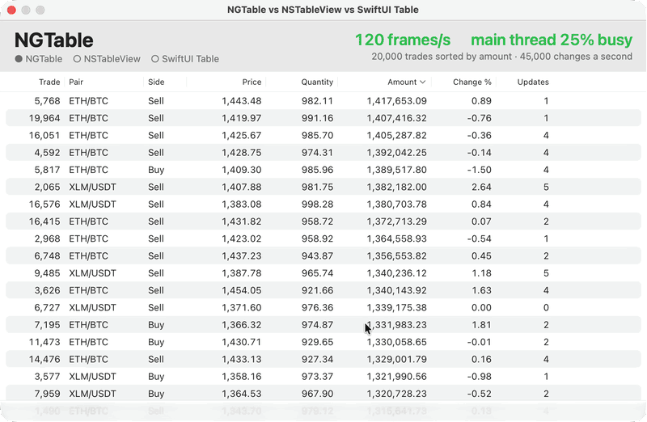

# NGTable


A fast AppKit table for business data on macOS: frozen columns, column groups,
a summary row with formulas, row grouping with subtotals, search and filters,
live updates, and a selection that stays on the same records across reloads.
The GPU draws it, and its API mirrors `NSTableView`, so apps migrate without
reworking their patterns.

> [!NOTE]
> **Free for noncommercial use** (personal projects, study, research,
> schools, universities, charities). **Using it in a business needs a
> commercial license**, including internal tools: write to
> **d.polikhranidi+ngtable@gmail.com**. See [Licensing](LICENSING.md).

## Why NGTable



20,000 live trades sorted by amount, 45,000 changes a second, in each table in
turn (a Release build on Apple silicon, 120 Hz screen). NGTable sorts the rows
itself and moves only the changed ones; NSTableView and SwiftUI's Table leave
sorting to the app, which sorts again after each change. The app is in
[`Comparison`](Comparison): `swift run -c release --package-path Comparison
NGTableComparison`.

More scenarios, measured the same way. Main thread: the share of time it was
busy (less is more room for your app). Frames: screen updates a second.

| Scenario | NGTable | NSTableView | SwiftUI Table |
| --- | --- | --- | --- |
| Live trades sorted by amount: 20,000 rows, 45,000 changes a second | ~15% · 120 frames | 97% · 17 frames | 99% · 3 frames |
| Order book: 200,000 rows, 244,000 changes a second | 51% · 120 frames | 97% · 28 frames | doesn't load the rows |
| Trade feed: 1,000,000 rows, 300,000 changes a second | 61% · 120 frames | 97% · 15 frames | doesn't load the rows |
| Binance live tickers: 3,100 pairs | 58% · 120 frames | 100% · 4 frames | 99% · 18 frames |
| Binance order books: 58,000 levels | 17% · 118 frames | 99% · 7 frames | 100% · 0 frames |
| Sorting 1,000,000 rows by a text column | 0.34 s with NGTableICU (2 s without), the screen keeps drawing | 1.9 s, the app stops for it | — |

NGTable also sorts, filters, sums and highlights changes while doing it.

## Features

- **Frozen columns** at the leading and trailing edges, and **column groups**
  under a common header.
- **Summary row**: sums, averages, counts, minimums and maximums, value filters
  and **formulas** over other columns (e.g. ROI as a ratio of sums), for all
  rows, the selected rows or all except the selected ones. Large tables are
  summarized in the background.
- **Row grouping** by column values, several levels deep, under collapsible
  header rows with row counts and subtotals.
- **Search and filters** that hide rows without touching the data source.
- **Row identity**: the selection follows the same records when data is sorted
  or refreshed.
- **Live data**: targeted updates (`reloadData(forRowIndexes:columnIndexes:)`,
  inserts, removes, moves, batched with `beginUpdates()`/`endUpdates()`) cost
  what changed, also with 200,000 rows; `reorderRows(from:to:)` re-sorts
  without reading the rows again.
- **NSTableView's patterns**: the same data source, delegate, sort
  descriptor and notification names, a diffable data source like
  `NSTableViewDiffableDataSource`, and an adapter for an existing
  `NSTableViewDataSource`.
- **Context menus** built by the app, with Finder's rules for which rows a
  click is for.
- **Column customization**: resize, move, hide and show columns, saved and
  restored.
- Values as text, numbers, currencies, percentages, dates, check marks,
  colored **tags**, icon **marks**, **sparklines** (lines, areas, bars, wins and
  losses), **links**, **buttons**, **progress bars**, **ratings**, and
  **pictures and videos** by URL (loaded, cached and played under the pointer
  by the table); text that **wraps**, rows as high as it.
- Native feel: overlay scrollers, elastic scrolling, Liquid Glass summary bar
  on macOS 26, dark mode, accent colors, keyboard navigation, type select,
  copying to spreadsheets, VoiceOver.
- Fast with a million rows and hundreds of thousands of changes a second:
  the GPU (Metal) draws the rows from a glyph atlas, with Core Text's
  typesetting; changing a value costs no rasterization, and frames are drawn
  only when something visible changed.

Your app owns the data. The table sorts the rows itself (`sortsRows`, in the
background for large tables) or leaves sorting to your app like
`NSTableView`, and your app performs the actions of its buttons and menus.

> [!IMPORTANT]
> **Sorting large text columns? Add `NGTableICU`.** NGTable works on its own
> and sorts text like Finder on all cores: a million shuffled texts in about
> 3 seconds, in the background. With the optional
> [NGTableICU](NGTableICU.md) library the same sort takes about 0.6 seconds,
> in the same order, but your app grows by **about 9 MB per architecture**
> (ICU's code and its collation data: about 17 MB in a universal Intel +
> Apple silicon app). It is safe for the Mac App Store. Add the library (a
> second product of this package) and one line at launch:
>
> ```swift
> import NGTableICU
> NGTableView.defaultCollationKeyProvider = NGBundledICUCollation()
> ```
>
> Tables of a few thousand rows don't need it: they sort in milliseconds
> either way. See "Sorting a million rows" in the documentation.

In SwiftUI, `NGDataTable` works like `Table`:

```swift
NGDataTable(campaigns, selection: $selection) {
    NGDataColumn("Name", value: \.name)
    NGDataColumn("Spend", value: \.spend, format: .currency(code: "USD"), summary: .aggregate(.sum))
}
```

## Requirements

- macOS 14 or later (Liquid Glass on macOS 26 and later)
- iPadOS 17 or later builds the core (values, formats, summaries, sorting,
  grouping, the renderer) and NGTableICU; the table view for iPad is coming
- Swift 6.2 or later (Xcode 26 or later)

## Installation

In Xcode, choose **File > Add Package Dependencies**, enter the repository's
URL, and add the `NGTable` library to your app target. In a `Package.swift`:

```swift
dependencies: [
    .package(url: "https://github.com/ngtable/NGTable", from: "1.1.0"),
],
targets: [
    .target(name: "MyApp", dependencies: ["NGTable"]),
]
```

For fast sorts of large text columns, also add the optional `NGTableICU`
library, `.product(name: "NGTableICU", package: "NGTable")` (about 9 MB per
architecture, see the note above). Apps without it don't build its ICU.

### Versions

NGTable follows semantic versioning, with one rule for enums: a minor
version may add cases to the public enums that describe values, formats,
filters and summaries (`NGValueFormat`, `NGColumnFilter`, `NGCellValue`,
`NGAggregate` and the like), as 1.1 added the `.dates`, `.top` and
`.bottom` filters. Keep a `default` in a `switch` over
them, and updates won't stop your code from compiling. Only `NGColumnItem`,
`NGDataColumnItem`, `NGColumnPin` and `NGColumnVisibility.State` keep their
cases until the next major version.

> [!TIP]
> In the binary `NGTable.xcframework` (`XCFramework/build-xcframework.sh`,
> built with library evolution) enums may get new cases: a `switch` over one
> needs `@unknown default`. Only `NGColumnItem`, `NGDataColumnItem`,
> `NGColumnPin` and `NGColumnVisibility.State` are `@frozen` and switch
> without it.

## Quick start

```swift
import AppKit
import NGTable

struct Campaign {
    var id: String
    var name: String
    var spend: Double
}

@MainActor
final class CampaignTableData: NGTableViewDataSource {
    var campaigns: [Campaign] = []

    func numberOfRows(in tableView: NGTableView) -> Int {
        campaigns.count
    }

    func tableView(_ tableView: NGTableView, valueFor column: NGTableColumn, row: Int) -> NGCellValue {
        let campaign = campaigns[row]
        switch column.id {
        case "id": return .text(campaign.id)
        case "name": return .text(campaign.name)
        case "spend": return .number(campaign.spend)
        default: return .empty
        }
    }
}

final class CampaignsViewController: NSViewController {
    private let data = CampaignTableData()
    private let table = NGTableView(frame: .zero)

    override func loadView() {
        table.columns = [
            .column(NGTableColumn("name", title: "Campaign", width: 240, pin: .leading)),
            .column(NGTableColumn("spend", title: "Spend", width: 120, alignment: .automatic,
                                  format: .currency(code: "EUR"), summary: .aggregate(.sum))),
        ]
        table.rowIdentifierColumnID = "id"   // The selection follows the same campaigns.
        table.autosaveName = "Campaigns"     // The user's columns are remembered.
        table.dataSource = data
        view = table
    }

    func show(_ campaigns: [Campaign]) {
        data.campaigns = campaigns
        table.reloadData()                   // Always right after changing the data.
    }
}
```

## Rules that matter

1. Call `reloadData()` **immediately** after changing the data, before
   selecting, scrolling or returning to the run loop. Until then the table
   still asks about the old rows.
2. Row indexes in the API (selection, `clickedRow`, data source and delegate
   calls) are **data source indexes**, also while a filter hides rows. They are
   only valid until the next reload: keep record ids, not indexes, in menus and
   asynchronous work.
3. Give rows an **identity** (`rowIdentifierColumnID` or
   `tableView(_:identifierForRow:)`), unique per record.
4. The table holds its **data source and delegate weakly**; capture `self`
   weakly in `NGRowFilter.isIncluded`.
5. Keep `tableView(_:valueFor:row:)` a **cheap lookup**, and return static
   color constants for row tints and markers.
6. Don't put the table in an `NSScrollView`: it scrolls by itself.

## Documentation

The package has full DocC documentation: API reference for every public type
and member, and articles:

| Article | Covers |
| --- | --- |
| Getting Started | Adding the package, columns, data source, showing and reloading |
| Integrating into an App | A complete CRM screen: model, data source, sorting, search, filters, menus, refresh, live updates, checklist |
| Migrating from NSTableView | The NSTableView → NGTableView mapping, the data source adapter, diffable data sources, what works differently |
| Defining Columns | Options, frozen columns, groups, icon columns, user customization, saving layouts |
| Displaying Values | Value kinds, formats, tags, marks, sparklines, links, buttons, progress bars, ratings, pictures and videos, the pointer over cells |
| Summaries | Aggregates, value filters, formulas, scopes, group subtotals, large tables |
| Filtering and Search | Row filters, search matching, row indexes while filtering, empty states |
| Grouping Rows | Groups by column values, header rows with subtotals, collapsing, order of groups |
| Selection and Sorting | Selection API, row identity, sorting, re-sorting without reloading |
| Menus and Actions | Row context menus, actions, copying |
| Appearance | Sizes, row tints and markers, selection style, scrolling |
| Keyboard and Accessibility | Keyboard commands, type select, VoiceOver |
| Performance and Threading | GPU rendering, what the table reads and when, large data, live updates, memory |

To read it in Xcode, open the package (or your app that uses it) and choose
**Product > Build Documentation**; it opens in the documentation window.
Symbol documentation also shows in Quick Help (Option-click a symbol). The
sources are in `Sources/NGTable/NGTable.docc`.

## Demo

The `NGTableDemo` scheme is a small app with ad campaign data: frozen and
grouped columns, marks, a ROI formula, search, a filter, summary scopes, row
tints, a context menu and 0 to 100,000 rows. Choose the scheme and run it
(Command-R). Its source, `Sources/NGTableDemo/NGTableDemo.swift`, is a working
example of most of the API; row grouping and targeted updates aren't in the
demo yet (the articles show them).

The log viewer in `Demos/LogViewer` shows the Mac's own logs as they come,
or the last hour of them (about a million entries): times with
milliseconds, levels as tags, wrapped messages, search, column filters,
grouping and export, and the frames a second it gets meanwhile:

```sh
swift run -c release --package-path Demos/LogViewer
swift run -c release --package-path Demos/LogViewer NGTableLogViewer --last 60
```

## Tests

Run the tests with the `NGTable-Package` scheme in Xcode (Command-U), or
`swift test` in the package folder.

## Package layout

| Path | Contents |
| --- | --- |
| `Sources/NGTable/NGTable.swift` | Data source and delegate protocols |
| `Sources/NGTable/Model` | Columns, values, formats, summaries, filters, layouts (no AppKit) |
| `Sources/NGTable/AppKit` | `NGTableView` (the class in `NGTableView.swift`, its parts in `NGTable*.swift` extensions) and its header, row grouping, updates, menus and accessibility |
| `Sources/NGTable/Metal` | The GPU renderer: shaders, the glyph atlas, Core Text shaping |
| `Sources/NGTable/NGTable.docc` | Documentation articles |
| `Sources/NGTableDemo` | The demo app |
| `Sources/NGTableICU` | The optional NGTableICU library ([NGTableICU.md](NGTableICU.md)) |
| `Vendor/CollationICU` | The ICU it is built with, made by `Scripts/vendor-icu.py` |
| `Tests/NGTableTests` | Unit and view tests |
| `Tests/NGTableICUTests` | NGTableICU's tests |
| `XCFramework` | The binary frameworks' builds (`ICU`: NGTableICU's) |
| `Comparison` | The app that compares NGTable with NSTableView and SwiftUI's Table (`Docs/comparison.gif`) |
| `Demos/LogViewer` | A log viewer of the Mac's logs |

## License

NGTable is source-available, under two licenses: free for noncommercial use
(personal projects, study, research, schools, universities, charities and
other noncommercial organizations) under the
[PolyForm Noncommercial License 1.0.0](LICENSE-NONCOMMERCIAL.md), and a
commercial license for use in a business, internal tools included. A
commercial license covers a major version (all of 1.x), and apps shipped with
it stay licensed. To buy one, write to **d.polikhranidi+ngtable@gmail.com**.
See [LICENSING.md](LICENSING.md); `NGTableView.version` tells which version
you have.

## Contributing

Bug reports, questions and ideas are welcome as issues; pull requests aren't
taken for now. See [CONTRIBUTING.md](CONTRIBUTING.md).
